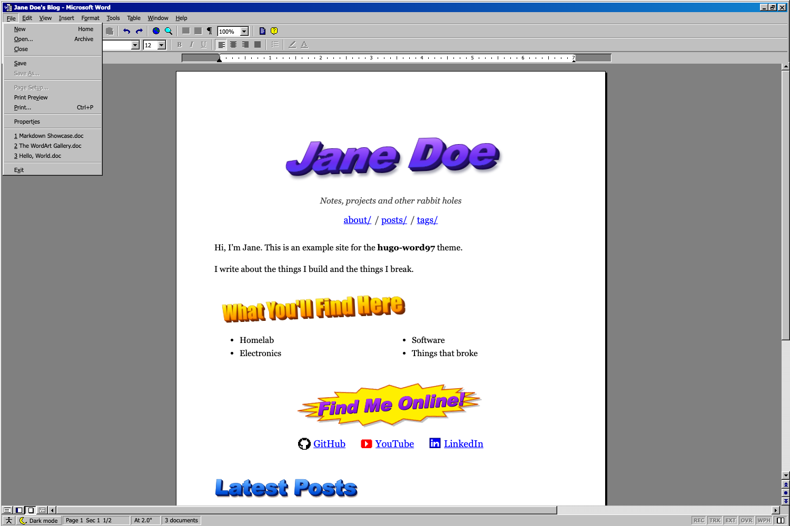

# hugo-word97

A Hugo blog theme that looks like a word processor from 1997, running on Windows 98: beveled chrome, working menus, flat toolbars, a ruler, a status bar, WordArt headings and an optional paperclip assistant. It's still a fast, accessible static site, so long technical posts stay readable.



> **Disclaimer:** this is a fan homage. It is not affiliated with, endorsed by, or sponsored by Microsoft. "Microsoft" and "Word" are trademarks of Microsoft Corporation. All icons, the paperclip character and the WordArt effects are original artwork drawn in SVG/CSS; no Microsoft assets are included.

## Features

- **Window chrome:** title bar with minimize, restore and close (close asks "Do you want to save changes?" and drops you to a Win98 desktop), a menu bar (File, Edit, View, Insert, Format, Tools, Table, Window, Help), Standard and Formatting toolbars, a ruler, a scrollbar and a status bar.
- **Controls that do something:** New (home), Open (archive), Print, Find (client-side search), Back/Forward, Copy, Select All, reading font, size and zoom, text alignment, formatting marks (¶), Document Map (table of contents), Normal / Online / Page Layout views, Full Screen, Word Count, and File > Properties. Controls that can't apply to a read-only document are shown disabled, as Word did.
- **WordArt:** ten styles (`purple`, `orange`, `blue`, `wave`, `rainbow-wave`, `rainbow`, `chrome`, `outline`, `classy`, `burst`) as a partial and a shortcode. They're drawn with CSS from real text, so headings stay selectable, searchable and screen-reader friendly. Insert > WordArt lets visitors restyle the home page title.
- **Blog parts:** home page with intro, topics, social links and latest posts; an Explorer-style "My Documents" archive with cover thumbnails and pagination; tag and category folders; a by-year archive; and posts with reading time, prev/next links and a Copy button on code blocks.
- **Dark mode:** a toggle that is always visible in the status bar (also in View and the toolbar). It follows the OS setting until the visitor chooses. The document stays white paper.
- **Accessibility options:** text size, a Windows-style High Contrast scheme and always-underlined links, opened from the status bar. Semantic landmarks, a skip link, keyboard-operable menus (arrow keys, Home/End, Esc, mnemonic letters), native `<dialog>` focus handling, visible focus and `prefers-reduced-motion` support.
- **Responsive:** full chrome on desktop, compact toolbars on tablets, and a title bar plus a touch-sized menu bar on phones.
- **No dependencies:** vanilla CSS and JS through Hugo Pipes, system fonts only, no CDNs. About 36 KB gzipped per first visit (HTML + CSS + JS + icons).
- **Hugo features:** RSS, sitemap, canonical URLs, Open Graph/Twitter cards (cover image), JSON-LD, Google Analytics through Hugo's built-in template, a print stylesheet, and an optional cookie notice.

## Requirements

Hugo **0.146.0 or newer** (uses the 0.146 template layout; the standard edition is enough, extended is not required). Tested on Hugo 0.153.3.

## Installation

### As a Hugo Module

```toml
# hugo.toml
[module]
  [[module.imports]]
    path = "github.com/B1T3X/hugo-word97"
```

```sh
hugo mod init github.com/you/your-site   # once, if your site isn't a module yet
hugo mod get -u
```

### As a git submodule

```sh
git submodule add https://github.com/B1T3X/hugo-word97.git themes/hugo-word97
```

```toml
# hugo.toml
theme = "hugo-word97"
```

### Try the example site

```sh
cd themes/hugo-word97/exampleSite
hugo server --themesDir ../..
```

## Configuration

Everything is optional. A full example:

```toml
title = "Jane Doe"

[params]
  description = "Notes, projects and other rabbit holes"   # tagline under the title
  author = "Jane Doe"                                       # or { name = "Jane Doe" }
  twitter = "janedoe"                                       # twitter:site / twitter:creator

  [[params.social]]            # "Find Me Online!", the footer and Insert > Hyperlink
    name = "GitHub"
    url = "https://github.com/jane"
    icon = "github"            # github | youtube | linkedin (or omit)

  [params.word97]
    documentName = "Jane Doe's Blog"   # title bar: "<documentName> - Microsoft Word"
    aboutPage = "/about"               # homepage intro + Help > About; omit to hide
    showIntro = true
    mainSections = ["posts"]           # default: Hugo's site.MainSections
    archiveTitle = "My Documents"
    latestPostsCount = 8
    titleStyle = "purple"              # WordArt style of the home page title
    topicsTitle = "What You'll Find Here"
    topicsStyle = "orange"
    topics = ["Homelab", "Electronics", "Software"]
    socialTitle = "Find Me Online!"
    latestTitle = "Latest Posts"
    latestStyle = "blue"
    accessibilityOptions = true        # built-in a11y dialog; false if you use a third-party widget
    footerLinks = [{ name = "Privacy", url = "/privacy/" }]

    [params.word97.cookieNotice]       # off by default
      enable = true
      message = "This site uses cookies for analytics."
      dismiss = "OK"
      linkText = "Privacy Policy"
      linkURL = "/privacy/"

# Navigation: menus.main (or params.navlinks = [{ name, url }])
[[menus.main]]
  name = "about/"
  pageRef = "/about"
  weight = 1

# Recommended: class-based highlighting, so code blocks use the theme's light
# "Visual Studio" palette and follow High Contrast mode. Without it, Hugo's
# default inline Monokai colors are used (also fine).
[markup.highlight]
  noClasses = false
```

### Front matter

| Key | Effect |
|---|---|
| `title`, `date`, `lastmod`, `description` | Title bar, meta line, summaries, SEO |
| `tags`, `categories` | Tag buttons and the "Keywords" / "Category" footer |
| `cover.image`, `cover.alt` | Cover image on the post, thumbnail in lists, social card (page-bundle file or a `/static` path) |
| `private: true` | Hidden from lists, search and prev/next (the page itself still builds) |
| `author` | Per-post author (falls back to `params.author`) |

### Optional pages

| Page | Front matter |
|---|---|
| Search results page (lets `?q=` links and no-JS form posts work) | `layout: search-results` |
| All posts grouped by year | `layout: archives` |

Search itself needs no setup. The theme publishes its own index as a fingerprinted JSON asset.

## WordArt

In templates:

```go-html-template
{{ partial "wordart.html" (dict "text" "Hello" "style" "orange" "level" 2) }}
```

In Markdown:

```md


Find Me Online!
```

| Param | Values | Default |
|---|---|---|
| `text` | the heading text (or use inner content) | (none) |
| `style` | `purple` `orange` `blue` `wave` `rainbow-wave` `rainbow` `chrome` `outline` `classy` `burst` | `blue` |
| `level` | `1`–`6` for `<h1>`–`<h6>`, `0` for a `<p>` | `2` |
| `class`, `id` | extra class / anchor id | (none) |

## Shortcodes

| Shortcode | Usage |
|---|---|
| `wordart` | See above |
| `figure` | `` resolves page-bundle files |
| `gallery` | `...figures...` |
| `photogallery` | `` grid of every `.webp` in `static/images/trip` |

## Customizing

- **Hooks:** add `layouts/_partials/hooks/head-end.html` (end of `<head>`, e.g. extra JSON-LD or meta tags) or `layouts/_partials/hooks/body-end.html` (before `</body>`, e.g. a third-party widget) to your site.
- **Overrides:** copy any file from `layouts/` or `assets/` into the same path in your site.
- **Colors:** the CSS custom properties at the top of `assets/css/base.css` (`--face`, `--title-a`, `--workspace`, `--page-w`, `--page-mx` and so on).
- **Icons:** the 16-color pixel icons are ASCII art in `tools/icons.py`. Edit them, then run `python3 tools/icons.py` to regenerate `assets/icons/sprite.svg`.
- **Syntax colors:** `assets/css/syntax.css` (from `hugo gen chromastyles --style=vs`).

Visitor preferences (dark mode, font, view, assistant and so on) are stored in `localStorage` only.

## Browser support

Current Chrome, Edge, Firefox and Safari. WordArt falls back to solid colors where `background-clip: text` is unsupported, and the wave style needs CSS `sin()` (2023+ browsers).

## Known limitations

- UI strings are English and not yet run through Hugo's i18n.
- The menus, toolbars and dialogs are written into every page: about +40 KB raw / +5 KB gzipped of HTML per page.
- Only one language per site has been tested.

## License

[MIT](LICENSE). Icons and artwork included.
